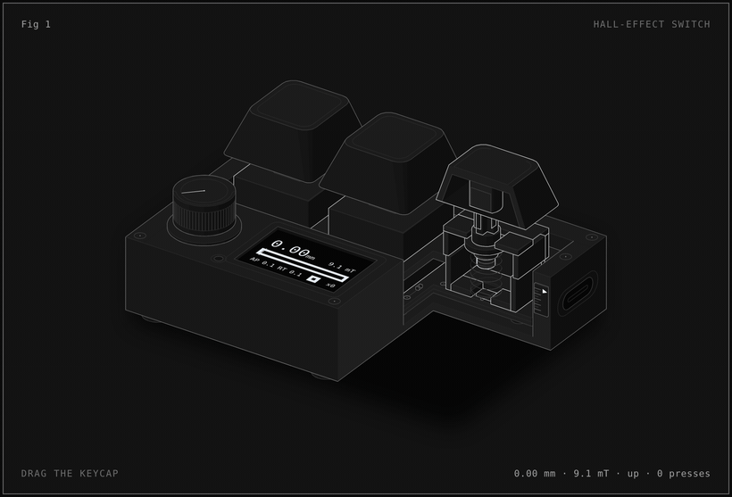

# hall-effect-figure

**[Try it live →](https://raydish1.github.io/hall-effect-figure/)** Drag the keycap, change the actuation point and rapid-trigger sensitivity, and watch the presses register.

Builds an interactive isometric figure of a hall-effect keyboard switch using the [Anatomy](https://github.com/wheresryan22/anatomy) skill (vendored in `.claude/skills/anatomy`, MIT licensed).

## The figure

`figure/hall-effect-switch.html` is a standalone page (no network needed), served live on GitHub Pages at the link above; the root `index.html` redirects to it. It follows the system light or dark theme and has a theme toggle. `hall-effect-switch-light.html` and `hall-effect-switch-dark.html` are fixed-theme builds.

It shows a small three-key aluminium macropad with its front right corner cut away through the third switch. A magnet in the stem moves 4.0 mm toward a hall sensor on the PCB. The firmware turns the field it reads back into depth, and the OLED on the case shows the depth, the field and every registered press. Drag the keycap, or focus the figure and use ↑/↓ (Shift for 1 mm steps, End to bottom out, Escape to let go). The buttons under the card change the actuation point (0.1–4.0 mm) and the rapid-trigger sensitivity (0.1 mm steps) and turn rapid trigger on or off. When idle, the figure plays a full press, uneven bounces near the bottom, a long lift and a press back down, a rocking half press, a full release and two light taps. At the default settings (actuation 1.5 mm, rapid trigger 0.3 mm) that is 7 presses, or 2 with rapid trigger off.

- `figure/model.mjs`: the switch and firmware model (field curve, depth from field, actuation and rapid trigger). Both the page and the build use it.
- `figure/build.mjs`: the drawing. Run `node figure/build.mjs`, adding `--light` or `--dark` for the fixed-theme pages.
- `figure/live.js`: the interaction, inlined into the page.
- `media/hall-effect-switch-dark.gif` / `.mp4` and `media/hall-effect-switch.gif` / `.mp4`: one loop of the idle tour, captured frame by frame from the page. The dark recording uses actuation 0.1 mm and rapid trigger 0.1 mm (9 presses); the light one is the earlier, simpler tour at the defaults.

The field comes from the exact on-axis formula for a Ø3 × 2 mm NdFeB magnet (Br 1.2 T), 5.6 mm from the sensing element at rest and 1.6 mm at the bottom. The magnet size and gaps are illustrative, not taken from a particular switch.
